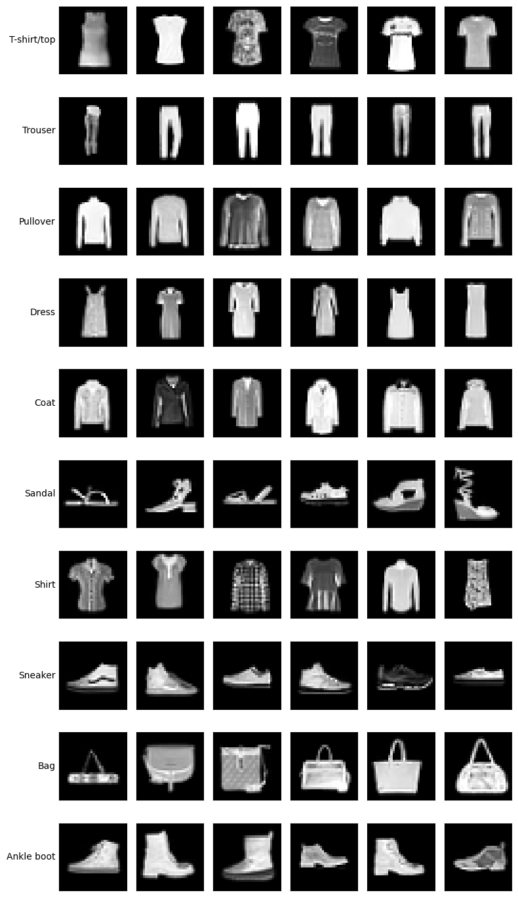
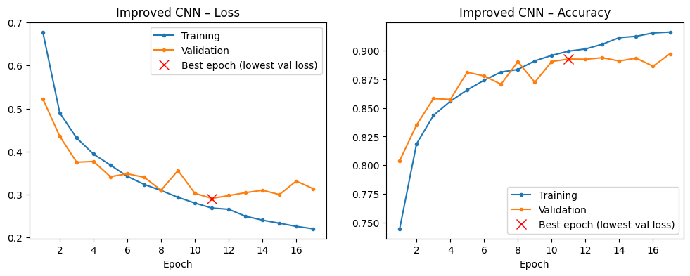
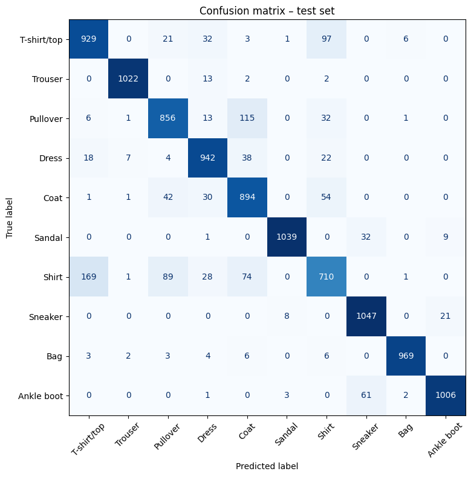

# Fashion-MNIST Clothing Classification with Neural Networks in PyTorch

How much better are convolutional networks than plain feed-forward networks at recognising clothing in small grayscale images?

This project trains seven neural networks in PyTorch on 52,500 Fashion-MNIST images (32×32 pixels, 10 classes). It compares network depth, the Adam and SGD optimisers, and regularisation with batch normalisation and dropout. Every model uses the same training procedure, with fixed random seeds and early stopping on validation loss.



## Results

The best model is a **convolutional network (CNN)** with **89.66% accuracy on the held-out test set** (89.28% on validation).

| Model | Parameters | Best epoch | Validation accuracy |
|---|---|---|---|
| **Improved CNN** | 1,974,538 | 11 | **89.28%** |
| First CNN | 1,974,538 | 6 | 87.38% |
| Deeper FNN (Adam) | 280,058 | 11 | 83.66% |
| Deeper FNN + batch norm + dropout | 280,730 | 20 | 83.19% |
| Small FNN (SGD with momentum) | 16,570 | 11 | 80.08% |
| Small FNN (Adam) | 16,570 | 11 | 79.03% |
| Small FNN (plain SGD) | 16,570 | 20 | 69.33% |



### Main findings
- **Convolutions matter most.** The improved CNN is 5.6 points above the best feed-forward network (FNN). Changes to the FNN's optimiser or regularisation moved its accuracy by only about one point.
- **The optimiser's settings matter more than the optimiser.** Plain SGD with a small learning rate was too slow, but SGD with momentum matched Adam.
- **Shirts are the hardest class** (F1 0.71). They are most often predicted as T-shirts, pullovers or coats, which share the same outline at 32×32 pixels. Trousers, bags and sandals are almost always correct.



### Limitations
- Each model was trained once, with one seed, so differences of about one point may be due to chance.
- Training was capped at 20 epochs, and CNN hyperparameters were not tuned systematically.
- Data augmentation was not tried.

## Method

1. Split the labelled data into training (60%), validation (20%) and test (20%) sets with a fixed seed.
2. Train every model with cross-entropy loss and batch size 32 for up to 20 epochs. Keep the weights with the lowest validation loss, and stop early when it stops improving.
3. Compare feed-forward networks (depth, optimiser, regularisation) and two CNN architectures.
4. Evaluate the model with the best validation accuracy once on the test set: accuracy, per-class precision and recall, and the confusion matrix.

The notebook uses a GPU automatically when one is available (NVIDIA CUDA or Apple Silicon), otherwise the CPU.

## Repository structure

```
├── fashion_mnist_neural_networks.ipynb   # full analysis, with outputs
├── download_data.py                      # downloads the data files from the release
├── data/
│   └── README.md                         # data format and source
├── images/                               # figures used in this README
└── requirements.txt
```

## How to run

```bash
pip install -r requirements.txt
python download_data.py        # downloads train.csv and evaluate.csv (~180 MB) into data/
jupyter notebook fashion_mnist_neural_networks.ipynb
```

The data files are attached to the [v1.0.0 release](https://github.com/Kepler-438b/fashion-mnist-neural-networks/releases/tag/v1.0.0). You can also download them from there by hand and put them in `data/`.

On a laptop CPU the full run takes about 30 minutes, mostly for the two CNNs. With a GPU it takes a few minutes. Trained weights are saved to `models/`, and predictions for the unlabelled images to `results.csv`.

## Data

The images are a 32×32 version of [Fashion-MNIST](https://github.com/zalandoresearch/fashion-mnist) by Zalando Research, released under the MIT License. The data files are too large for the repository itself, so they are published as release assets (see How to run).

## About

Originally developed as coursework in machine learning at the Faculty of Information Technology, Czech Technical University in Prague. Restructured, corrected and documented as a standalone project.

**Tools:** Python, PyTorch, scikit-learn, pandas, NumPy, Matplotlib, Jupyter
